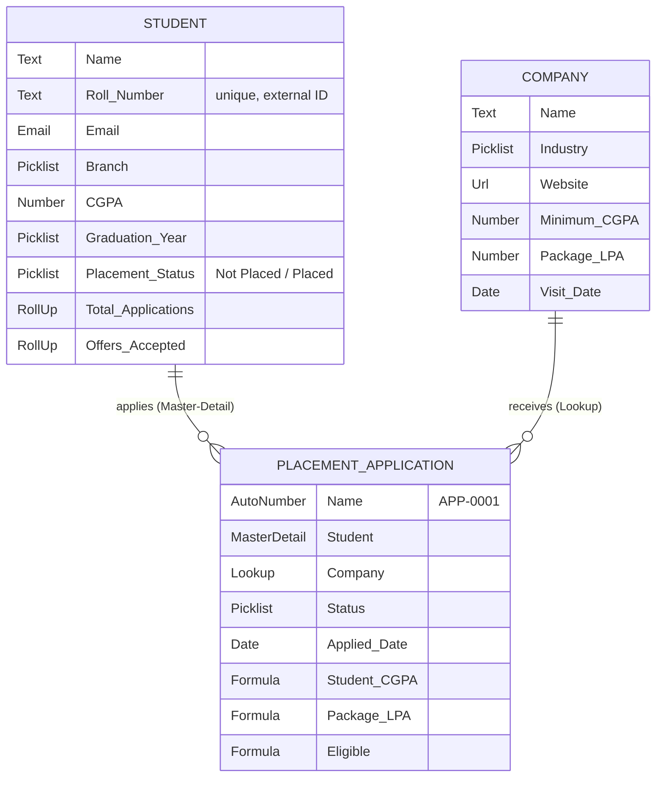

# Student Placement Tracker (Salesforce Admin Project)

A Salesforce app that a college placement cell could use to track **students**, **visiting companies** and **placement applications**. It is built almost entirely with **clicks, not code**: custom objects, fields, validation rules, a record-triggered Flow, permission sets, roles, sharing rules, reports and dashboards.

> **Built for learning.** This repo has the deployable metadata. Some core Admin features (the approval process, reports, dashboard, users and the duplicate rule) are left for you to build by hand in Setup. See [`docs/BUILD_BY_HAND.md`](docs/BUILD_BY_HAND.md).

---

## What the app does

| Business need | Salesforce feature used |
|---|---|
| Store students, companies and applications | 3 custom objects with custom fields |
| One student, many applications | **Master-Detail** relationship (Application → Student) |
| One company, many applications | **Lookup** relationship (Application → Company) |
| Count each student's applications and accepted offers | **Roll-Up Summary** fields |
| Show the student's CGPA and the package on each application | **Formula** fields (cross-object) |
| Block applications below the company's CGPA cut-off | **Validation Rule** |
| Lock an application once the offer is accepted | **Validation Rule** with `PRIORVALUE()` |
| Mark the student "Placed" automatically | **Record-Triggered Flow** (after save) |
| Officers manage everything; students see limited data | **Permission Sets** |
| Officers report to a Placement Head | **Role Hierarchy** |
| Students are private, but officers can see all of them | **OWD = Private** + **Criteria-Based Sharing Rule** |
| One place to work from | **Lightning App** with custom tabs |
| Officer approves offer acceptance | **Approval Process** *(build by hand)* |
| Placement statistics | **Reports and Dashboard** *(build by hand)* |

## Data model



**Organization-Wide Defaults:** Student = Private, Company = Public Read Only, Placement Application = Controlled by Parent.

## Project structure

```
force-app/main/default/
├── applications/     Placement Tracker Lightning app
├── flows/            Offer Accepted → mark Student as Placed
├── layouts/          Page layouts for the 3 objects
├── objects/          Objects, fields and validation rules
├── permissionsets/   Placement Officer, Placement Student
├── roles/            Placement Head → Placement Officer
├── sharingRules/     Share all students with Placement Officers
└── tabs/             Custom tabs
data/                 Sample records (4 companies, 6 students, 10 applications)
docs/                 Build-by-hand exercises and learning guide
manifest/package.xml  Manifest of all metadata
```

## How to deploy it

### 1. Get a free org
Sign up for a free **Developer Edition** org at <https://developer.salesforce.com/signup>. A Trailhead Playground also works.

### 2. Install the tools
- [Salesforce CLI](https://developer.salesforce.com/tools/salesforcecli) (`sf`)
- [VS Code](https://code.visualstudio.com/) with the **Salesforce Extension Pack** (optional, but makes learning easier)

### 3. Deploy

```bash
git clone https://github.com/<your-username>/student-placement-tracker.git
cd student-placement-tracker

# Log in to your Developer org (opens a browser)
sf org login web --alias placement --set-default

# Deploy all metadata
sf project deploy start --source-dir force-app

# Give yourself access
sf org assign permset --name Placement_Officer

# Load sample data
sf data import tree --plan data/sample-data-plan.json

# Open the org
sf org open
```

In the org, open the **App Launcher** (9-dot icon) and choose **Placement Tracker**.

### 4. Try it out
1. Open **Ananya Rao**. Her Placement Status is already **Placed**, because her application to Nimbus Cloud Labs was loaded as *Offer Accepted* and the Flow ran.
2. Open **Karthik Menon's** application to Acme Technologies and change the status to **Offer Accepted**. Then check that Karthik is now **Placed**.
3. Try changing that accepted application again. The validation rule blocks it.
4. Try creating an application for **Rahul Verma** (CGPA 6.8) to **Ledgerline Finance** (cut-off 8.0). The validation rule blocks it.

### Troubleshooting
- **Sharing rule or role errors:** move the `sharingRules` folder out of `force-app` temporarily, deploy, move it back, and then run `sf project deploy start --metadata SharingRules`.
- **A deploy fails partway:** the error names the file and line. Fix that one file and run the same deploy command again. Nothing in the org is half-changed, because deploys are all-or-nothing.
- **Tab icon (motif) error:** open `tabs/*.tab-meta.xml` and change `<motif>` to another icon, such as `Custom20: Airplane`.
- **Data import fails on an application:** check that the student's CGPA meets the company's minimum. That's the validation rule working.

## Learn it
- [`docs/LEARNING_GUIDE.md`](docs/LEARNING_GUIDE.md) explains what every piece does and why, and lists the interview questions it prepares you for.
- [`docs/BUILD_BY_HAND.md`](docs/BUILD_BY_HAND.md) has step-by-step exercises to finish the project in Setup.

## Skills demonstrated
Salesforce Administration · Custom Objects and Fields · Master-Detail and Lookup Relationships · Roll-Up Summary and Formula Fields · Validation Rules · Flow Builder (Record-Triggered Flow) · Approval Processes · Permission Sets · Profiles and Roles · OWD and Sharing Rules · Lightning App Builder · Page Layouts · Reports and Dashboards · Data Import · Salesforce CLI / SFDX
